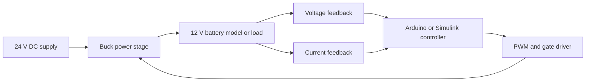

# CC–CV DC–DC Battery Charger

An academic team project exploring a 24 V to nominal 12 V buck-converter charger with constant-current and constant-voltage control. The repository contains the Arduino firmware, Simulink model, and Proteus schematic used during the prototype work.

## Design overview



The design uses an N-channel MOSFET, freewheeling diode, inductor, output capacitance, voltage divider, and ACS712 current sensor. The controller changes the PWM duty cycle to regulate charging current or battery voltage.

## Two control implementations

- **Arduino firmware:** switches from current regulation to voltage regulation using measured battery voltage.
- **Simulink model:** demonstrates separate PI loops with SOC-based mode selection.

## Repository contents

```text
firmware/     Arduino CC–CV control prototype
model/        Simulink battery-charger model
simulation/   Proteus schematic
```

## Key parameters in the prototype firmware

| Parameter | Value |
| --- | ---: |
| Nominal input | 24 V DC |
| CV target | 12.6 V |
| CC target | 1.0 A |
| PWM ceiling | 140 / 255 |
| Current sensor assumption | ACS712 5 A, 0.185 V/A |

These values came from the academic prototype and are not universal charger settings.

## Engineering limitations and next steps

- Calibrate the voltage divider and ACS712 offset on the actual hardware.
- Scale the integral term by elapsed time and add anti-windup before treating the controller as production-quality.
- Verify MOSFET gate-drive voltage, switching losses, inductor saturation current, diode current rating, and thermal performance.
- Add hardware overcurrent, overvoltage, reverse-polarity, and overtemperature protection.
- Validate the control transition with logged voltage and current data across the full charge cycle.

## Safety

This is an educational prototype, not a certified battery charger. Test with a current-limited bench supply and a safe load before connecting a battery. Battery chemistry, cell count, and manufacturer limits must determine the final charging profile.

## Project context

This was completed as a university team project. The repository documents the available design artifacts without assigning unverified individual ownership of team work.

Academic portfolio material. No license is granted for reuse.
